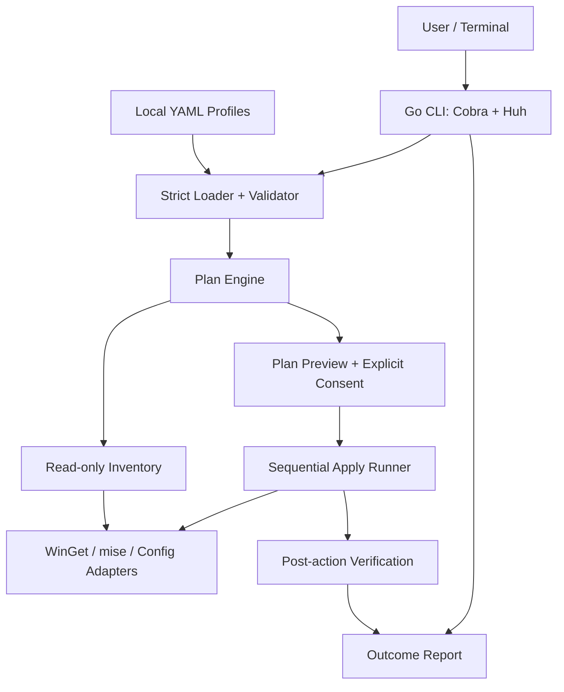

# Architecture — HelloKit CLI

**Status:** Target design, not implemented. Windows-only adapter in MVP, platform-neutral core contracts.

## 1. System context



The **CLI UI**, **profile format**, **plan model**, and **platform adapters** are separate. The core must not need an HTTP server or database to operate.

## 2. Modules and responsibilities

| Module | Owns | Must not do |
| --- | --- | --- |
| `cli` | Parse commands, render prompts/errors, gather approvals | Decide readiness based on formatted process output |
| `profile` | Load bounded YAML, schema validation, resolve named profiles | Execute shell commands |
| `platform` | OS/capability detection, well-known user directories | Mutate during read-only probe |
| `inventory` | Query actual package/tool/config state via adapters | Treat unknown data as installed |
| `plan` | Generate ordered immutable plan with dependencies and clear status | Create side effects or silently change requirements |
| `runner` | Execute approved steps with context cancellation and post-checks | Re-plan secretly or suppress partial failure |
| `adapters/winget` | Install/query exact package identifiers | Install unapproved package / different source |
| `adapters/mise` | Runtime version inspection/install | Modify shell startup by default |
| `adapters/config` | Supported file diff/write/backup/verify | Write outside allowlisted user-owned targets |
| `report` | Summarize planned/applied/skipped/failed/unknown | Print tokens or secret-bearing file contents |

## 3. Contract: inventory -> plan -> apply

1. **Load** explicit path, named local profile, or read-only starter preset.
2. **Validate** version/structure, exact package IDs, duplicates, unknown keys, sensitive paths, and requested capabilities.
3. **Probe** platform, WinGet availability, package sources, executable versions, supported config destinations.
4. **Inventory** returns typed states: `satisfied`, `missing`, `mismatch`, `unknown`, `blocked`. Distinguish successful query from inability to query.
5. **Plan** emits a deterministic list of actions with identity, source, desired state, current state, prerequisites, risk and expected verification check.
6. **Preview** and collect approval. Approval is bound to the plan fingerprint; if the environment changes materially between plan and apply, invalidate/review affected operations.
7. **Apply** only approved operations, sequentially in dependency order; track each step's result and allow graceful cancellation.
8. **Verify** requested state after each mutation, not merely process exit code.
9. **Report** success / partial / failed / cancelled with steps and remediation; do not promise installer rollback.

### Plan model (conceptual)

```text
Plan {
  profile_name, profile_digest, platform, generated_at,
  actions: [
    {id, kind, target, source, desired_version?,
     detected_state, prerequisites[], effect_summary,
     approval_scope, verification_method}
  ]
}
```

The digest is for guarding user consent; do **not** describe it as a cryptographic guarantee about installed artifacts or packages.

### Idempotence boundaries

- If exact desired state is verifiably present: `skip` and record it.
- If package exists but version cannot be reliably checked: mark `unknown`; no invisible install/upgrade.
- If request permits unconstrained newest version: report reproducibility as `floating`; subsequent runs may differ.
- If a step is interrupted: persist the result of verified completed steps and let a new plan recompute current state. Do not replay unverified mutations blindly.

## 4. Windows-specific integration notes

- Use `exec.CommandContext` and argument arrays for fixed `winget` and `mise` binaries; no shell invocation from untrusted input.
- A WinGet application is identified by **source + exact package ID**, not a display name.
- The `winget list` CLI exposes filters, but its plain-text table is not a guaranteed stable machine-readable interface across versions/locales. Prefer supported APIs or controlled detection/verification with explicitly documented limitations; fail closed to `unknown` where appropriate.
- Package licenses may require acknowledgement. A HelloKit `--yes` confirmation **must not** implicitly waive third-party license terms; acceptance must be an intentional, separately documented user action.
- Installation scope and elevation requirements are reported before apply when detectable; HelloKit must not silently elevate.
- Avoid assuming new executables appear in the existing process's PATH immediately after WinGet installs them. Re-resolve paths and explain when terminal restart is required.
- Runtime manager initialization / shell activation is **optional** and any shell profile edits require independent review.

## 5. Configuration file updates

- A config action declares an allowlisted target kind rather than arbitrary absolute paths in a profile.
- Resolve to known user directories and validate against traversal, junction/symlink escapes, UNC paths and reserved targets.
- Read current bytes, show human diff, make a verified backup in a user-owned location, then replace atomically when supported.
- Never overwrite unrelated keys if a scoped change is possible; report inability to merge safely rather than silently clobbering.
- Backups can restore config only. Installation packages may persist after failure and user must be told.

## 6. Storage and state

- Use OS-provided user config/cache locations (`os.UserConfigDir`, `os.UserCacheDir` where supported); avoid hard-coded `C:\\Users\\...` assumptions.
- Store user-created profiles separately from bundled read-only sample profiles.
- Allow one active invocation mutating the same machine state at a time; use a scoped process lock or equivalent to avoid conflicting HelloKit runs.
- Diagnostic logs are opt-in or local-only with redaction and a retention policy; no cloud upload in the MVP.
- Do not persist machine inventory or entire environment variables unless there is an explicit, narrow reason.

## 7. Architecture tests

- Core and plan packages should unit-test using fake adapters.
- No test of `plan` / `--dry-run` may reach mutating adapter methods.
- Golden tests for plan ordering, profile validation and diagnostic output.
- Disposable Windows VM E2E to validate actual WinGet and mise behavior, non-admin policy, offline mode and re-runs.

See [SECURITY_AND_TESTING.md](SECURITY_AND_TESTING.md) and [IMPLEMENTATION_PLAN.md](IMPLEMENTATION_PLAN.md).
