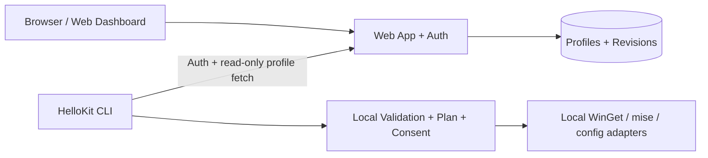

# Future Design — HelloKit Cloud (NOT MVP)

**Status:** Conceptual design; does not authorize building a website/backend during the Windows CLI MVP.

## 1. User experience

- User creates an account on a future HelloKit website.
- Web UI creates/edits one or more profiles: **Estzdev**, Work, Fullstack, custom names.
- Profile editor offers supported packages, exact versions, config switches and schema validation. It previews a serialized declarative profile.
- User signs into CLI through a browser-assisted flow, lists remote profiles and explicitly chooses one.
- CLI downloads a pinned profile revision, validates it locally, shows the same install plan and asks for approval.
- Website edits **never automatically execute commands** on any user's laptop.

## 2. Separation of concerns



- **Local CLI owns device execution.**
- **Web service owns account identity and versioned profile storage.**
- Neither server nor downloaded profile can push arbitrary scripts or run commands remotely.
- Without login/network, local profiles remain functional.

## 3. Future API shape (illustrative only)

```text
GET    /api/v1/profiles
GET    /api/v1/profiles/{id}/revisions/{revision}
POST   /api/v1/profiles
PATCH  /api/v1/profiles/{id}
GET    /api/v1/profiles/{id}/revisions
```

Auth routes and protocol are not decided. Use a standards-based browser-assisted login flow and secure token storage provided by the OS. CLI scopes should be minimal; profile read access does not confer install permission.

## 4. Data model concepts

- `users`: immutable internal ID, auth-provider subject, account metadata.
- `profiles`: owner, friendly name, visibility, current revision pointer.
- `profile_revisions`: immutable JSON/YAML-equivalent declarative document, schema version, timestamp, author, integrity hash.
- `profile_shares` (later): explicit access controls for shared profiles.

Avoid storing private keys, passwords, arbitrary shell scripts or raw whole-machine inventory. Encrypt traffic, minimize server logs, and design export and account deletion before production launch.

## 5. Sync semantics

- No automatic remote overwrite of an edited local file.
- Explicit origin labels: `local`, `builtin`, `cloud`.
- Pinned revision use for reproducible execution. A mutable profile name may resolve to newest revision only after showing its revision/digest.
- On conflict, offer a visible diff / choose source / save as new revision; no silent last-write-wins for profiles that might change someone's machine.
- Offline mode uses only explicitly stored local copies with provenance; never pretend a stale revision is current.

## 6. Candidate web stack (reassess at Phase 3)

- SvelteKit + TypeScript for UI and initial API endpoints.
- PostgreSQL for accounts and revision history.
- Standard OAuth/OIDC integration, PKCE where applicable, and platform-secure token storage for CLI.
- No separate Go API, Redis, message queue or microservices unless real traffic, security or product requirements demonstrate need.

## 7. Future release gates

- Cross-device profile selection validated through a real login flow.
- Profile write/read permissions and tenancy isolation tested.
- Compromised/malicious profile data cannot bypass the local validation/approval pipeline.
- Local offline workflow still passes its full test suite.
- Threat review completed for token theft, leaked public profiles, account takeover and profile revisions.
